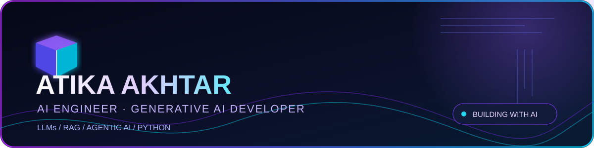
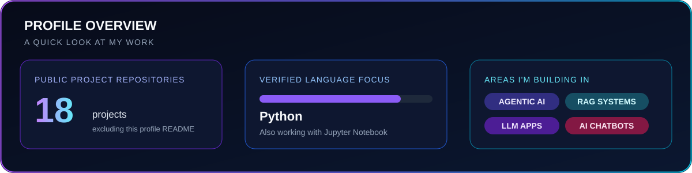

<!-- ATIKA AKHTAR | NEON DARK PRO | Profile README -->

  <a href="https://www.linkedin.com/in/atika-akhtar-367045261/">LinkedIn</a>
  &nbsp;·&nbsp;
  <a href="https://github.com/atikaakhtar101110-debug">GitHub</a>
  &nbsp;·&nbsp;
  <a href="https://github.com/atikaakhtar101110-debug?tab=repositories">All repositories</a>

**Building useful AI applications with Python, LLMs, retrieval, and intelligent workflows.**

---

## 01 / About Me

Hi, I'm **Atika Akhtar** — an AI-focused developer interested in turning modern AI capabilities into practical applications.

- **Generative AI:** LLM-powered applications and conversational systems.
- **Agentic AI:** Multi-agent workflows for research and business automation.
- **RAG:** Knowledge-grounded applications and retrieval-based experiences.
- **Applied development:** Python, APIs, data workflows, and interactive applications.

I'm continuously learning, improving my engineering practices, and exploring ways to make AI applications more useful and reliable.

## 02 / Profile Snapshot

## 03 / Selected Projects

Four projects that give a quick view of the work in my repositories.

<table>
<tr>
<td width="50%" valign="top">

### [01 · Multi-Agent Research System](https://github.com/atikaakhtar101110-debug/multiagentaisystem)

A Streamlit research assistant that coordinates search, page reading, report writing, and critic review through a multi-step agent pipeline.

**Focus:** Agent workflows · Research automation · Streamlit

[View repository →](https://github.com/atikaakhtar101110-debug/multiagentaisystem)

</td>
<td width="50%" valign="top">

### [02 · Business Lead Finder](https://github.com/atikaakhtar101110-debug/Businesses_Lead_Finder)

A multi-agent pipeline that discovers, enriches, qualifies, verifies, and scores business leads from an ideal customer profile and location.

**Focus:** Multi-agent systems · Data enrichment · Lead scoring

[View repository →](https://github.com/atikaakhtar101110-debug/Businesses_Lead_Finder)

</td>
</tr>
<tr>
<td width="50%" valign="top">

### [03 · Customer Support Chatbot API](https://github.com/atikaakhtar101110-debug/chatbott)

A FastAPI chatbot that retrieves relevant FAQ content, grounds LLM responses, and flags conversations for human escalation.

**Focus:** FastAPI · Retrieval · LLM integration

[View repository →](https://github.com/atikaakhtar101110-debug/chatbott)

</td>
<td width="50%" valign="top">

### [04 · Social Media Report Generator](https://github.com/atikaakhtar101110-debug/social_media_report_generator)

A Streamlit application that analyses campaign data and produces a downloadable Excel report.

**Focus:** Data analysis · Streamlit · Excel reporting

[View repository →](https://github.com/atikaakhtar101110-debug/social_media_report_generator)

</td>
</tr>
</table>

## 04 / More Repositories

<strong>Explore 14 additional projects</strong>

| Repository | Project area |
|:--|:--|
| [E-Commerce Data Cleaning Pipeline](https://github.com/atikaakhtar101110-debug/ECommerce-Data-Cleaning-Pipeline-1k) | Python · Pandas · Data cleaning |
| [Real Estate Prediction API](https://github.com/atikaakhtar101110-debug/real_estate_model) | FastAPI · Property value estimation |
| [Financial Risk App](https://github.com/atikaakhtar101110-debug/financial-risk-app) | Financial risk project |
| [Credit App](https://github.com/atikaakhtar101110-debug/credit_app) | Credit application project |
| [Credit Loan App](https://github.com/atikaakhtar101110-debug/credit_loan_app) | Credit and loan project |
| [Credit Risk App](https://github.com/atikaakhtar101110-debug/credit_risk_app) | Credit risk project |
| [Student Mental Health Prediction](https://github.com/atikaakhtar101110-debug/student_mental_prediction) | Prediction project |
| [NLP & Deep Learning](https://github.com/atikaakhtar101110-debug/NLP_DL) | NLP · Deep learning |
| [Emotional Intelligence](https://github.com/atikaakhtar101110-debug/Emotional_intelligence) | Machine learning project |
| [Multi-Agent Project](https://github.com/atikaakhtar101110-debug/multiagent) | Agent-based project |
| [Customer Churn](https://github.com/atikaakhtar101110-debug/customer_churn) | Customer churn project |
| [Chatbot](https://github.com/atikaakhtar101110-debug/chatbot) | Chatbot project |
| [RAG Business Knowledge](https://github.com/atikaakhtar101110-debug/rag-business_knowlegde) | Retrieval-augmented generation |
| [RAG Nimblrex](https://github.com/atikaakhtar101110-debug/rag_nimblrex) | RAG exploration |

[Browse all 18 public project repositories →](https://github.com/atikaakhtar101110-debug?tab=repositories)

## 05 / Technology & Learning

**Verified from the repository content reviewed**

- **Primary language:** Python
- **Data and ML:** Pandas, scikit-learn, Jupyter Notebook
- **Application development:** FastAPI, Streamlit
- **AI interests:** Generative AI, LLM applications, RAG, multi-agent systems

**Currently exploring**

- Agentic AI patterns and orchestration
- Retrieval quality and knowledge-grounded generation
- Reliable, testable LLM application design

## 06 / GitHub Contributions

Your live contribution calendar and contribution activity are available in GitHub's native profile activity section below this README. I’m intentionally not embedding third-party contribution images here, so this section does not depend on an external image service.

[View GitHub contribution activity →](https://github.com/atikaakhtar101110-debug)

---

## 07 / Let's Connect

  <a href="https://www.linkedin.com/in/atika-akhtar-367045261/"><strong>CONNECT ON LINKEDIN</strong></a>
  &nbsp;·&nbsp;
  <a href="https://github.com/atikaakhtar101110-debug"><strong>FOLLOW ON GITHUB</strong></a>

*Curious minds · Practical AI · Continuous growth*

